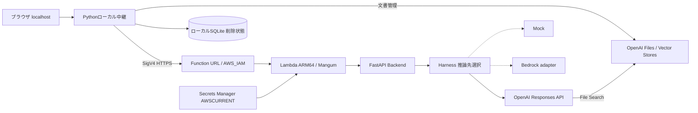

# Personal LLM System

> このリポジトリは公開専用の匿名化コピーです。元のGit履歴・稼働先URL・資格情報・DBは含みません。新規の1コミットから開始し、元開発環境のタグは継承しません。

個人向けLLMアプリを、API設計・AWS配備・認証・文書検索・削除状態管理まで段階的に開発したポートフォリオです。
既存LLMを学習・開発した作品ではなく、外部LLMを安全に利用する周辺システムの設計と実装を扱います。

**正式基盤はv1.0、公開コピーには開発側で別コミットに分離したv1.1 CSV拡張も含みます。**
個人用localhost構成であり、一般ユーザー向けの公開Webサービスではありません。

## 主な機能と実装範囲

| 機能 | 状態・範囲 |
|---|---|
| 通常チャット・会話履歴 | 実装済み。OpenAIを利用したAWS経由E2Eを記録済み |
| 推論先の分離 | Mock / OpenAI / Bedrockアダプター。既定はMock。UIでのモデル選択は未実装 |
| 文書管理 | PDF・TXT・Markdownの登録・索引状態・選択・関連付け解除 |
| File Search・出典 | OpenAI標準機能。許可Storeと選択文書IDに限定。架空文書で実E2E確認 |
| 削除制御 | SQLiteへ開始状態を先行保存。ローカル検索拒否と再起動後の永続性を確認 |
| CSV拡張（v1.1） | UTF-8/BOM、引用符・セル内改行を検証してTXT化。架空CSVで検索・出典を確認 |
| 汎用ツール実行・在庫更新 | v0.5に設計資料あり。実装済み機能としては扱わない |

Mockは決定的な応答であり、文脈理解や実API接続の証拠にはしません。
BedrockアダプターはMock検証済みですが、現資料から実モデル推論の成功は確認できません。

## システム構成



推論はLambda経由、文書登録・一覧・削除はローカル中継からOpenAIへ直接接続します。
Lambdaへ配備するのは`app/`と依存関係であり、Web UIとSQLiteはローカルに置きます。
詳細は[アーキテクチャと責任境界](docs/architecture.md)を参照してください。

## 技術スタック

| 分類 | 使用技術 |
|---|---|
| Backend・入力検証 | Python、FastAPI、Pydantic |
| 推論・文書API通信 | httpx、OpenAI Responses / Files / Vector Stores API |
| AWS連携 | boto3、SigV4、Lambda、Function URL、Secrets Manager |
| 配備定義 | AWS SAM / CloudFormation、Docker、Python 3.13 ARM64イメージ |
| UI | HTML / CSS / JavaScript。表示はtextContentを使用 |
| 状態管理 | Python標準sqlite3。会話内容のDB保存はしない |
| テスト | pytest、FastAPI TestClient、Node.js標準テストランナー |

OpenAIとの通信はhttpxで実装し、OpenAI SDKには依存していません。

## 設計判断と制約

- BackendはHTTP、Harnessは推論先の選択、アダプターは認証・通信・応答形式を担当します。
- LLMの回答品質と、システムの許可判定・入力検証・削除制御を分離します。
- AWS認証情報はboto3標準設定、LambdaのOpenAIキーはSecrets Managerから取得します。ブラウザには渡しません。
- ローカル中継は127.0.0.1限定。Host/Origin・CSRF検証、固定転送先、リダイレクト禁止を維持します。
- 履歴はブラウザメモリ内のみ。本文各4,000文字・履歴20件・チャット本文16 KiB、文書は最大5 MiBです。
- DELETEの成功応答と、GET 404による反映確認を区別します。中断時は未確認として残し、自動でDELETEを再送しません。
- ローカルSQLiteはLambdaから参照できません。Lambda直接呼び出しには、削除開始直後の拒否を同じ範囲では保証できません。

採用理由と代替案は[技術選定・トレードオフ](docs/design-decisions.md)にまとめています。

## 安全なローカル確認（Mock）

Python環境と依存関係を準備した後、以下は外部LLMやAWSを使わずBackendを確認できます。
PowerShellの例です。

```powershell
python -m venv .venv
.\.venv\Scripts\python.exe -m pip install -r requirements.txt
$env:HARNESS_BACKEND = 'mock'
.\.venv\Scripts\python.exe -B -m uvicorn app.main:app --host 127.0.0.1 --port 8000
```

別ターミナルから`POST http://127.0.0.1:8000/chat`へ`{"message":"こんにちは"}`を送信すると、
`{"response":"Mock: こんにちは"}`が返ります。API仕様は`http://127.0.0.1:8000/docs`で確認できます。

**公開コピーのlocal_webは通信できない`example.invalid`を固定参照します。** Clone直後のオフラインデモには上記Backendを使用し、
UIから稼働Lambdaには接続しません。`deploy/verify_*.py --execute`は外部操作を含むため無条件に実行しないでください。
AWS・実API接続には自分の環境設定と利用料金の確認が必要です。
環境別の配備手順・旧README全文・バックアップは公開コピーから除外しています。

## テストと検証

2026-10-18、`aaca836`のCSV拡張を含むソースに対してオフライン実行しました。

```powershell
.\.venv\Scripts\python.exe -B -m pytest -q -p no:cacheprovider
node --test tests/ui_history.cjs tests/ui_documents.cjs
```

- Python：**271件成功**、Mangumの既存DeprecationWarningが1件。
- UI：**10件成功**。外部APIはMock化し、テスト用一時DBを使用。
- v1.0単独の238 Python / 8 UIは2026-10-17の保存済み結果。今回は再実行していません。
- 過去の実E2E：通常チャット・履歴・CSV由来TXT検索・出典・detach・再起動後の拒否を確認。
- 実E2Eは架空データと個人用構成に限定。内部ツール回数・実トークン使用量・請求額は未取得。

[検証結果と証拠の範囲](docs/portfolio/verification.md)に、今回の再実行と過去の記録を分けて記載しています。

## ファイル構成

```text
app/                   Backend、Harness、推論アダプター、Lambda入口
local_web/             localhost UI・SigV4中継・文書管理・SQLite制御
tests/                 Python / UIのオフラインテスト
deploy/                限定実API検証用スクリプト・準備資料
docs/                  設計、履歴、配備・E2E記録、ポートフォリオ資料
events/chat.json       Lambda用の架空テストイベント
template.yaml          SAM定義
Dockerfile.lambda      ARM64 Lambdaイメージ定義
```

## 開発経緯・AI支援の範囲

v0.1のBackend/Harness分離から、Lambda、SigV4中継、OpenAI、会話履歴、File Search、削除状態永続化へ拡張しました。
元の開発Gitには7つのコミット単位で記録され、すべての版が個別コミットに分かれているわけではありません。
[開発履歴](docs/development-history.md)に根拠と不明点を記載しています。

AIによるコード・テスト・資料作成支援を利用しています。
人間による目的・制約の指定、構成の採用、AWS/IAM・キーの手動設定、課金・削除・配備の承認、
PowerShell実行や画面での確認と、AIによる実装・調査支援を[担当範囲](docs/portfolio/contributions.md)で区別しています。
ソースから個々の行の作成者や独立した実装能力を証明するものではありません。

## リリースと今後の改善点

- 元開発環境のv1.0タグは`00a0a52`、CSV拡張は`aaca836`。これらは開発経緯の参照であり、公開Gitには存在しません。
- [公開版と開発版の関係](docs/releases/release-organization.md)を参照。公開コピーは配備イメージそのものではなく、ここから実環境を復旧する手順は配布していません。
- モデル選択、利用量の可観測性、依存関係固定・CI、公開サービス向け認証は今後の課題。
- 文書のプロンプトインジェクション、正確な集計、元ファイルの他用途確認には未解決事項があります。
- 公開前チェックは[セキュリティ確認](docs/portfolio/publication-security.md)を参照。
  公開コピーは新規履歴で匿名化済みです。秘密値パターン検査の限界と第三者権利の確認範囲を記録しています。プロジェクトのライセンスは付与していません。

資料の入口は[docs一覧](docs/README.md)。Wantedly・Green向けの短い紹介文は[紹介文案](docs/portfolio/profile-summary.md)に用意しています。
GitHubへのpush・公開設定変更は実施していません。
