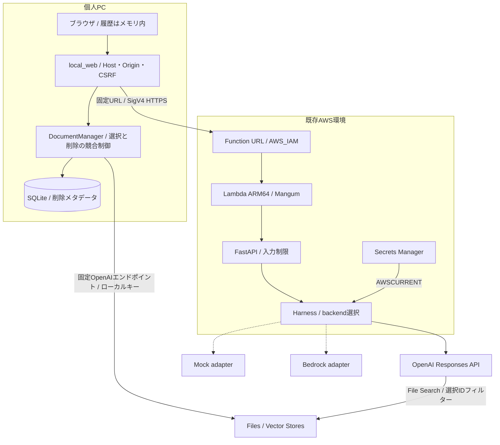
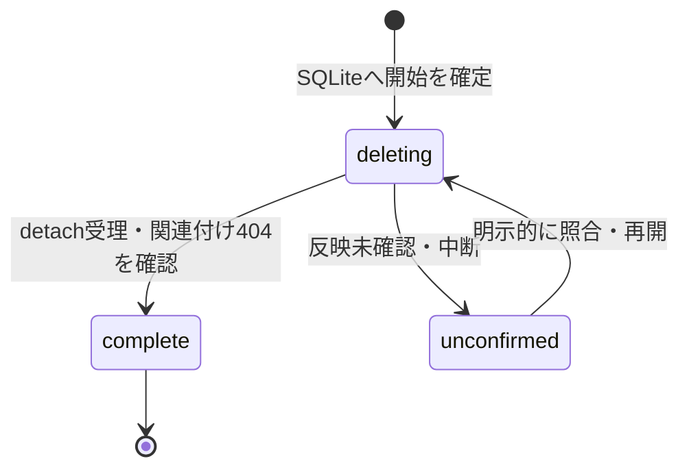

# アーキテクチャと責任境界

2026-10-18、ソースと保存済み配備・E2E記録に基づく。AWSの現在状態は再照会していない。

| モジュール | 責任 |
|---|---|
| `app/main.py` / `app/api/chat.py` | FastAPI入口、型・入力制限、HTTP応答・一般化エラー |
| `app/conversation.py` / `app/file_search.py` | 履歴・role・容量、Store許可、共通出典形式 |
| `app/harness/core.py` | Mock / OpenAI / Bedrockの選択。HTTPや画面から独立 |
| `app/harness/openai_api.py` | 認証取得、Responses通信、文書の存在確認、回答と出典の変換 |
| `app/lambda_handler.py` | MangumによるLambdaイベントとASGIの接続 |
| `local_web/server.py` | localhost配信、CSRF、標準AWS認証、SigV4、固定先への転送 |
| `local_web/documents.py` | 登録・一覧・状態・選択・削除とクライアント抽象化 |
| `local_web/deletion_store.py` | Store ID + File IDを一意にした削除状態。sqlite3を使用 |
| `local_web/csv_documents.py` | v1.1の検証・TXT変換。Lambdaイメージには含まない |

## 保存先と検索範囲

会話履歴はブラウザメモリ内。キーはローカル環境変数またはLambdaのSecrets Manager参照。
文書はOpenAIへ送信・保存される。ブラウザメモリのみという方針は、外部文書保存まで禁止する意味ではない。
SQLiteには文書本文・会話・キーを保存せず、ID・表示名・削除状態等の制御メタデータを保存する。
表示名も私的情報になり得るためDB全体を公開対象外とする。

Store許可と明示的な文書IDをサーバーで検証し、ID属性を検索フィルターに指定する。
File SearchはOpenAI固有の機能であり、Bedrockへ同じ検索をそのまま移せる共通実装ではない。

## 削除の状態遷移

元ファイル削除モードでは、他用途不使用の確認と元Filesの404確認も必要。
実クライアントで他用途不使用を証明できない場合は元ファイル削除を拒否する。
`complete / detached=true`は元ファイル消去と同義ではない。
再起動時のDELETE自動再送はしない。ローカル検索は削除記録があれば拒否する。
同一中継プロセスのロック・DBトランザクションを越える分散排他は実装していない。
Lambda直接利用ではローカルDBを参照できず、同じ即時拒否保証はない。

## 実装していないもの

独自モデル学習、自前のベクトル検索基盤、公開Webログイン、複数ユーザー認可、
汎用エージェントループ、在庫書換え、UIモデル選択は未実装。
LLMの回答正確性・文書中の悪意ある指示への完全耐性を保証しない。
