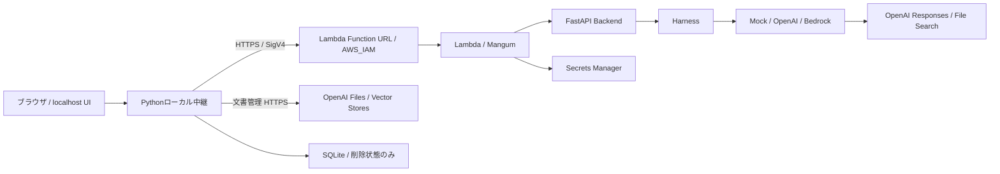

> 公開用匿名化コピー。下記のGit ID・タグ・検証結果は元の開発環境の記録です。公開Gitの履歴・現時点の外部サービス動作を示すものではありません。

# 個人LLMシステム 開発記録 v0.6

基準日：2026年10月15日
用途：就職活動・技術面接に向けたポートフォリオの原資料

追記（2026-10-17）：本書は10月15日の時点記録として維持する。
その後、v1.0のAWS E2Eと実中継再起動後の削除状態維持を確認した。
現在の構成・v1.1 CSV拡張との分離は[リリース構成](../releases/release-organization.md)、
後続履歴は[開発履歴](../development-history.md)を参照。

## 1. 記録の範囲と到達点

既存のLLMを利用する個人用アプリケーションを、API、クラウド実行、Web UI、会話履歴、
文書検索、削除状態管理へ段階的に拡張した。独自LLMの学習や検索エンジンの開発ではない。

本書はREADME、Git履歴、設計書、開発セッションのテスト出力、実API検証結果と
台帳の読み取り調査に基づく。資料作成に際して、新たな実API通信やAWS操作は行っていない。
過去の設計書には作成時点の「未実行」などが残るため、現在のコードと後続の確認結果を区別した。
履歴から日付を特定できない版について、開発日や所要時間を推測していない。

| 表記 | 意味 |
| --- | --- |
| 実装済み | 現在のローカル作業ツリーにコードが存在する。配備済みとは限らない |
| Mock検証済み | 外部サービスを偽物に置き換え、対象の制御・形式を自動テストした |
| 実API検証済み | 承認された範囲で実サービスとの通信を確認した。別バージョンへの保証ではない |
| 未検証・設計のみ | 動作確認または実装が完了していない |

2026年10月15日時点の要約：

- **AWS稼働環境**：v0.4の通常チャット。OpenAIへの実通信成功を記録済み。
- **ローカルの最新実装**：v0.6.5の削除安全性改善と、v0.6.6のSAM設定追加まで。
- **最新の自動検証**：Python 238件、UI 8件成功。SAM lintとARM64ビルド成功。
- **文書検索の実API確認**：架空TXTの選択検索・出典取得は成功。削除確認には未解決事項あり。
- **v0.6のAWS統合**：準備段階。新イメージのAWS配備、本番用Vector Storeの確認・作成、
  AWS経由の文書検索E2Eは未実施。

## 2. 開発目的と背景

目的は、通常の会話能力を持つLLMを、安全な個人用Webアプリとして利用する基盤を作ること。
将来のモデル変更や文書検索・業務ツール追加を、HTTP処理や画面全体の作り直しにしない構成を目指した。

開発では次を重視した。

1. Backendと推論制御の責任を分離する。
2. 外部サービスを使えない段階でもMockで開発・回帰確認できるようにする。
3. 認証情報をブラウザやGitへ渡さない。
4. 課金・権限変更・配備など副作用のある操作を、検証と承認の単位に分ける。
5. 正常系だけでなく、通信失敗、部分成功、再起動、削除反映遅延を扱う。

コード生成支援を利用した開発であり、成果はソース・テスト・実行記録で確認する。
生成された実装や説明を、そのまま実環境での成功証拠にはしない方針を採った。

## 3. v0.1〜v0.6.6の開発履歴

| 段階 | 主な成果 | 検証・到達範囲 |
| --- | --- | --- |
| v0.1 | FastAPIの`/chat`、独立したHarness、単一メッセージの入力検証、依存定義・テスト | 最小Backendの基盤を実装 |
| 初期Bedrock対応 | boto3アダプター、標準認証設定、環境変数によるモデル選択、機密情報を伏せた障害ログ | 接続処理・エラー処理を実装。実モデル推論成功は本書では確認できない |
| v0.2〜v0.25 | MangumのLambda入口、SAM、Docker ARM64、Mock切替、Lambda Invoke・入力異常の確認 | 作業記録上、LambdaからMock応答のHTTP 200を確認 |
| v0.3 | localhost UI、Python中継、SigV4、固定転送先、CSRF・Host/Origin検証 | Web UIからLambdaのMock経路を確認 |
| v0.4 | OpenAI Responses APIアダプター、Secrets Manager、プロバイダー切替 | ローカル・Lambdaの実通信成功。最終Web UI E2E成功はユーザー確認 |
| v0.5 | Allowlist付きCSV分析ツール、承認区分、入力・回数・費用制御の設計 | **設計と実装計画のみ**。CSVツール・自律ツール実行は未実装 |
| v0.6.1 | 複数ターン履歴、従来API互換、role・文字数・件数・総サイズ制限 | Mock検証とローカル実API確認。AWS未配備 |
| v0.6.2 | Store許可リスト、File Search指定、共通出典形式 | Mock検証。後続の限定実APIテストで検索・出典を確認 |
| v0.6.3 | PDF/TXT/Markdown管理、一覧・状態・選択・削除UI、文書属性フィルター | 実装・Mock検証。管理UI全体の実API E2Eは未確認 |
| v0.6.4 | 実API検証スクリプト、リソース台帳、復旧スナップショット、削除反映待ち | 架空TXT検索は成功。関連付け消失を期限内に確認できない事象を調査 |
| v0.6.5 | SQLite削除状態、開始時の検索拒否、明示的再開、競合制御、元Files存在確認 | Python 232件・UI 8件成功。新しい削除フローの実API確認は未実施 |
| v0.6.6 | 許可Store IDのSAMパラメーター、Lambdaイベント経由のMock確認、配備・復旧準備 | Python 238件・UI 8件、lint・ARM64ビルド成功。AWS読み取り確認とバックアップ完了 |

Gitで確認できる主な復旧地点：

| コミット・タグ | 履歴に記録された内容 |
| --- | --- |
| `5028bc6` | 初期コミット |
| `f1e31b9` | FastAPI HarnessのBedrock接続 |
| `8336241` / `v0.4` | OpenAI・Lambda・ローカルWeb統合の完成記録 |
| `65cce63` | v0.5の許可済みCSVツール設計・実装計画 |
| `0cd1c04` | v0.6.1〜v0.6.4の実API検証前チェックポイント |

本書作成時のHEADは`0cd1c04`。その後の削除安全性改善・配備準備には未コミット変更と
未追跡ファイルがある。最新実装全体がコミット・タグで固定済みとは扱わない。

## 4. アーキテクチャと技術選定

これは最新ローカル設計の経路であり、全経路のAWS配備・実E2E完了を示す図ではない。
AWSで実証済みなのはv0.4の通常チャット経路である。

| 技術・構成 | 採用理由と役割 |
| --- | --- |
| Python / FastAPI / Pydantic | HTTP入口と型・制約のある入力検証を構成し、推論処理と分離する |
| Harnessとアダプター | Backendをプロバイダー固有の認証・JSON形式から分離する |
| Mock | 認証情報・課金・モデル利用可否に依存せず異常系まで確認する |
| Lambda / Mangum | FastAPIをASGIアダプター経由でLambdaへ載せ、ローカル入口を維持する |
| SAM / Docker | インフラ定義とLambda用依存環境を管理し、ARM64環境でビルドする |
| boto3 / SigV4 | ローカルの標準AWS認証設定を使い、ブラウザへ認証情報を渡さず署名する |
| OpenAI Responses / File Search | 推論と文書検索に既存APIを利用し、自前の検索基盤を増やさない |
| SQLite | 追加サービス・追加ライブラリなしで、ローカルの削除状態を再起動後も維持する |

低コストを設計目標とする一方、継続運用の月額費用、性能比較、可用性SLAは測定していない。

### 各層の責任

- **Backend**：`/chat`の入力検証、Harness呼び出し、共通HTTP応答・一般化されたエラー。
- **Harness**：設定に基づく推論先の選択と、履歴・文書指定の受け渡し。
  現段階で汎用エージェントループや任意ツール実行を実装したものではない。
- **アダプター**：各サービスの認証、通信、リクエスト変換、回答・出典の正規化。
- **Lambda**：Backendを動かす実行環境。会話や削除状態の永続保存先にはしない。
- **ローカル中継**：localhost保護、AWS署名、文書管理、ローカル削除状態と検索の競合制御。
- **OpenAI API**：回答生成、文書の索引化・検索を提供する外部サービス。

## 5. LLMの能力とシステム機能を分ける設計思想

「モデルが自然言語を扱えること」と「アプリケーションが安全に機能すること」を別問題として扱った。

| モデル・外部サービスに依存するもの | 周辺システムが実装・保証すべきもの |
| --- | --- |
| 回答の生成・説明・推論品質 | 入力制限、認証、エラー分類、転送先固定 |
| 渡された過去発言を参照する能力 | 必要な履歴を次のリクエストへ含める処理 |
| 文書検索結果を使った回答生成 | Storeの許可、文書IDの指定、検索フィルター、削除中の拒否 |
| サービス固有の検索・出典形式 | 共通レスポンスへの変換と安全な画面表示 |
| 将来のツール選択の提案 | Allowlist、実行権限、承認、回数・費用上限 |

画面に履歴が表示されるだけでは、LLMに文脈は渡らない。v0.4の表示履歴とv0.6.1の履歴送信を
区別し、会話機能をシステム側の明示的な入力構築として実装した。

同様に、文書をUIで選択するだけでは検索範囲は制限されない。選択IDをAPI入力へ渡し、
サーバー側検証とFile Searchの属性フィルターへ反映して初めて検索対象を制限できる。
出典表示で選択外ファイルを隠すだけでは不十分なため、実検証では生の検索結果IDも確認した。

プロバイダー差異は消さずに境界へ集約する。Mockは決定的な応答、Bedrockは会話推論、
OpenAIは会話とFile Searchという能力差がある。共通インターフェースがあることを、
全モデルが同じ機能・品質を持つことや、設定変更だけで検索機能まで移植できることと混同しない。

モデル設定の差し替えと、権限・削除・再試行の実行制御は別である。将来のCSV設計でも、
モデルのToolCallを実行権限として信用せず、サーバー側で検証する方針を定義している。

## 6. 会話履歴・文書検索・管理機能

### 会話履歴

- 従来の単一`message`に加え、`history`を任意指定できる。
- 履歴roleは`user`と`assistant`のみ。ユーザー入力による`system`・`developer`の偽装を拒否。
- 本文・各履歴は最大4,000文字、履歴最大20件、チャットJSONは合計16 KiB。
- 会話はブラウザメモリ内で保持し、ディスク保存を追加しない。
- 検索対象の変更・削除操作時は画面の会話コンテキストをリセットする。
- OpenAIとBedrockには履歴を渡せる。Mockは現在メッセージの決定的応答であり、文脈理解を実証しない。

### File Search

- サーバーの`OPENAI_ALLOWED_VECTOR_STORE_IDS`でStoreを許可。未設定は拒否。
- 最新実装では明示的な`document_ids`が必須。Store全体検索は拒否する。
- 登録時の文書ID属性を`in`フィルターへ渡す。
- `file_citation`からファイルIDと表示名を抽出して共通の`sources`へ正規化する。
- 文書未指定なら通常チャット。BedrockのFile Searchは非対応として明示的に拒否する。

### 文書管理と削除状態

- PDF、UTF-8 TXT、Markdownを対象とし、最大5 MiB。形式・名前・サイズをサーバーで検証。
- ファイル転送はチャットと別経路にし、16 KiB制限を拡大しない。
- 登録、一覧、索引状態、選択、関連付け解除を提供する。
- SQLiteはOneDrive・Git管理外。キーは`Store ID + File ID`。
- 削除開始をトランザクションで保存し、外部DELETEより先に検索を拒否する。
- DELETE受理とGET 404を区別し、`deleting`、`unconfirmed`、`complete`を記録する。
- 再起動時にDELETEを自動再送しない。利用者が明示的に照合・再開する。
- 通常チャットはDB非依存。DB障害時は文書管理・ローカル文書検索を安全側に停止する。
- 元ファイルの他用途未使用を現行構成で確認できないため、実クライアントの元ファイル削除は
  既定で拒否。用途確認インターフェースを用いたMockでのみ後続の削除順序を検証している。

会話を保存しない方針と、削除状態を保存する方針は矛盾しない。前者は会話内容、後者は
再選択を防ぐための制御メタデータであり、目的とデータを分離した。

## 7. セキュリティ設計とトレードオフ

| 対策 | 防ぐ対象・トレードオフ |
| --- | --- |
| 127.0.0.1限定・Host/Origin検証 | ローカル中継の外部公開を避ける。個人利用に限定し公開サービスの認証を代替しない |
| CSRFトークン・Cookie検証 | 別サイトからの操作を抑制する。ローカル端末自体の侵害は防げない |
| 固定転送先・リダイレクト禁止 | 任意URL転送によるSSRFや認証情報転送を避ける |
| Function URLのAWS_IAM・SigV4 | ブラウザにAWSキーを埋め込まない。中継には利用可能なAWS認証が必要 |
| ローカル環境変数／LambdaのSecrets Manager | OpenAIキーをソース・画面に含めない。キーの所属プロジェクト・権限管理は別途必要 |
| Secret限定GetSecretValue | 不要な対象への読み取りを避ける。配備主体と実行主体の権限を分けて確認する |
| 入力・応答サイズ制限と安全な表示 | 巨大入力やHTML実行を抑える。ファイル検査はマルウェア対策全般を保証しない |
| HTTP本文は一般化、ログは安全な分類 | 認証情報の漏えいを抑える。一部の原因は追加診断が必要になる |
| SQLiteの削除拒否記録 | 再起動後も拒否を維持する。DB紛失・移動・複数プロセス運用への注意が必要 |
| 削除開始と文書チャットの直列化 | 競合を抑える。開始済みチャットの完了を待つため応答性を犠牲にする |

文書内容やモデルの回答は未信頼入力である。安全な画面表示と、モデルに対する
プロンプトインジェクション耐性は別問題であり、後者を完全に解決したとは主張しない。

## 8. 問題・原因・対応・検証

| 問題 | 確認した原因・切り分け | 対応と結果 |
| --- | --- | --- |
| 設定変更しても旧Bedrockモデルが使われる | ハードコードや設定優先順位の確認が必要だった | 環境変数からモデルを読み、起動ログとテストで選択を確認。実モデル成功とは別 |
| Bedrock利用を進められない | 利用承認・クォータが開発上の制約 | Mockを維持し、OpenAIアダプターを追加。Bedrockは削除しない |
| SAMのIAM Resource lintエラー | Ref解決後のARN形式と指定方法が問題 | SAMとして妥当な対象指定へ修正し、lintで確認 |
| ARM64端末でのビルド問題 | x86_64指定との不整合、後続にはDocker API接続・実行環境の問題も発生 | Lambdaをarm64へ統一。CLI起動とSAMクライアント生成後の処理を分けて調査し、後にビルド成功 |
| 配備時のiam:PassRole・ロールバック問題 | デプロイユーザー、CloudFormation、Lambdaの権限経路を分ける必要 | 対象ARN・条件を整理し、承認単位で作業。v0.4の配備と応答確認に到達。全履歴で常に最小権限だったとは扱わない |
| Lambdaで`secret_unavailable` | Secretの保存形式とJSONの`api_key`を要求するコードが不一致 | 形式修正後の別途承認された再検証で実通信成功。秘密値自体は調査ログに出さない |
| OneDrive上の台帳置換でPermissionError | ファイル置換が拒否された。同期機構の詳細な原因までは断定しない | TEMPへの保存、主台帳更新前の復旧スナップショット、記録済みIDによるcleanupを用意 |
| DELETE後のGET 200を即失敗扱い | 要求受理と反映確認を同一視していた | 期限・回数付きのGETへ変更。無制限再試行やDELETE再送を避ける |
| 元ファイルの確認まで到達しない | 関連付け404を待ってから元Filesを確認する逐次ロジック | 両対象を独立確認。後続テストで元Files 404・関連付け200を区別できた |
| 再起動後に削除途中の情報を失う | プロセスメモリだけで管理していた | SQLiteへ削除開始を先行保存し、Mockで復元・拒否・明示的再開を検証 |

Dockerについて、同じ症状をすべて「接続先の検出失敗」とは扱わなかった。
直近のv0.6.6では、SAMのローカルメタデータへのアクセス制限とビルド本体を分離し、
再実行でlint・ビルド成功を確認した。Docker CLIがPATH上にない環境でも、SAMと同梱SDKは
Dockerへ接続できた。過去の全ビルド失敗が単一原因だったとする証拠はない。

## 9. 自動テスト・実API検証の成果

### 自動検証

| 時点 | 結果 | 主な確認範囲 |
| --- | --- | --- |
| v0.4完成記録 | Python 95件成功、SAM lint成功 | アダプター、Secret取得失敗、Lambda、ローカル中継 |
| v0.6.5完了 | Python 232件・UI 8件成功 | DB障害、削除開始拒否、再起動、競合、期限、再開、通常チャット互換 |
| v0.6.6準備 | Python 238件・UI 8件成功 | 上記にLambdaイベント経由の6ケースを追加 |

最新のPython実行には既存の非推奨警告が2件あるが、テスト失敗はない。
件数は機能品質の指標の一つであり、性能・安全性の完全な証明とはしない。

追加Lambdaテストでは、イベント→Mangum→FastAPI→Harness→Secret取得Mock→HTTP Mockを通した。
正常系に加え、元ファイル不存在、関連付け不存在、未索引、文書未指定、未許可Storeを確認。
拒否すべき条件で推論POSTを送らないことも検証した。

SAM lintとビルドが成功し、ネットワーク無効の一時コンテナで以下を確認した。

- Linux ARM64、Python 3.13.16、aarch64。
- Mangumハンドラーを読み込み可能。
- 現在の`app`配下Python全14ファイルとイメージ内のSHA-256が一致。
- ローカル中継・SQLite実装はLambdaイメージへ含めない。

### 実サービスとの確認

| 対象 | 確認結果と証拠の範囲 |
| --- | --- |
| v0.4 Lambda通常チャット | READMEにHTTP 200、5.127秒、対応CloudWatchログに対象エラーなしと記録 |
| v0.4 Web UI最終E2E | UI→SigV4中継→Lambda→OpenAI→UIの成功をユーザーが確認 |
| v0.6.4 ローカル通常チャット | 提示された実行結果はBackend/OpenAIとも200、入力17・出力9・合計26トークン、3.471秒 |
| v0.6.4 複数ターン | 実通信成功のユーザー報告あり。本書で個別トークン・全文の再確認はしていない |
| 架空TXTの検索 | ALPHA-731とBETA-842を個別選択し、HTTP 200、仕様値、出典ID・表示名を確認 |
| 選択外の混入確認 | 生の取得検索結果ID・引用IDが選択ファイルのみであることを確認。回答表示だけの判定ではない |
| 削除済み文書の拒否 | ALPHA関連付けの404後、推論前の拒否を確認 |
| cleanup | 調査対象runでFilesとStoreの最終404を確認。検証合格とは別に記録 |

### 削除反映の調査結果

`file-search-4`では、元ファイルDELETEを受理した後も関連付けGETが200で、
確認処理は10.001秒で未完了になった。元ファイル自体はcleanupで404だった。
一覧にも対象があり、このrunでは単体GETとの不一致はなかった。

その後の`deletion-only-1`では、推論・File Search呼び出しをともに0回にして切り分けた。

| 元ファイルDELETE後の確認 | 記録 |
| --- | --- |
| 元Files GET | 0.885秒で404 |
| 関連付けGET | 1.971秒、5.298秒、8.294秒で200 |
| 次の関連付けGET | 確認期限内にHTTP結果を得られず |
| 終了 | 10.030秒、`unconfirmed` |
| cleanup | 元Files 404、Store DELETE成功後404、未解決リソースなし |

この結果により「元ファイル削除の確認」と「関連付け消失の確認」を分離できた。
ただし、関連付けが10秒以降に消えるのか、メタデータが残る挙動なのかは未確定。
Store削除前の関連付け404は確認しておらず、削除検証全体を成功扱いにしていない。

`file-search-4`の推論費用推定は約0.0065米ドルと記録されている。
これは検証スクリプトの推定であり、請求実額、保存費用込みの総額、現在の料金表の証明ではない。

## 10. AWS統合準備と復旧設計

v0.6.6でAWSを読み取り、稼働スタックの`UPDATE_COMPLETE`、Lambdaの`Active / Successful`、
arm64、Function URLの`AWS_IAM`、Secretの`AWSCURRENT`を確認した。
実行ロールには対象Secret限定のGetSecretValueがある。Secret値は取得していない。

配備済みテンプレートは展開済みCloudFormation形式だったため、新SAMもオフラインで展開して比較した。
比較用に旧イメージURIを揃えると、差分は許可Store用のパラメーターと環境変数だけだった。
IAMロール、Secret、Function URLの定義は一致した。将来の配備では別途コードイメージ更新が加わる。
実際の変更セットの作成・置換判定はまだ行っていない。

復旧用に、配備済みテンプレート、全パラメーター、Lambda設定、旧イメージURI・Digest、
Function URL設定、両実行ロールとポリシーをローカルへ保存した。
OneDrive・Git管理外で利用者とOSのSYSTEMだけにアクセスを制限し、
22ファイルのSHA-256とACLを検証した。保存先の個人識別情報は本書に記載しない。

復旧にはGitだけでなく、旧イメージ、旧設定、既存Secretの保持が必要。
バックアップは設定の記録であり、イメージレイヤーやSecret値を複製したものではない。
旧ECRイメージの存在は確認済みだが、タグは可変であり将来の手動削除を防ぐ保証はない。

本番用Vector Storeは未確認・未作成。ローカルとLambdaでStore IDを揃えるだけでなく、
両方のキーが同じOpenAIプロジェクトに属し、必要な操作権限を持つことを確認する必要がある。

## 11. 未実装・未検証・残存リスク

- **v0.6 AWS E2E**：コード配備と文書管理を含む統合実通信は未実施。
- **v0.6.5削除フロー**：Mock検証済みだが、改善後の実APIでの反映確認は未実施。
- **本番Store**：存在・プロジェクト・キー権限は未確認。文書アップロードも未実施。
- **PDFの実検索**：形式検証はMockで確認。実APIで今回確認した資料はTXTであり、PDF成功としない。
- **Bedrock実モデル**：通信実装とMock検証はあるが、実推論成功の確認はない。
- **CSV・任意ツール**：v0.5は設計のみ。Allowlist実行基盤・承認再開・レポート生成は未実装。
- **公開Web・複数ユーザー**：ログイン、ユーザーごとの文書権限、公開運用の認証は対象外。
- **削除開始直後の直接Lambda呼び出し**：LambdaはローカルDBを参照できず拒否を保証しない。
- **競合・既存情報**：検証と推論の間の外部変更、開始済み推論、過去の回答に含まれる情報は取り消せない。
- **元ファイル保持**：関連付け解除後もFilesは残り得る。用途確認後の別途管理が必要。
- **DB運用**：紛失・空DBへの切替で拒否情報を失う。複数中継プロセスの同時削除再開は非対応。
- **部分登録失敗**：削除開始前のアップロード所有情報は主にメモリ管理であり、
  削除状態の永続化が全アップロード工程の復旧を保証するわけではない。
- **タイムアウト・コスト**：文書数に比例する確認GETと推論の累積時間、継続運用費、厳密な費用上限は未検証。
- **品質・負荷**：少数の架空データによる機能確認であり、検索精度、幻覚率、並行負荷の定量評価は未実施。

## 12. 開発を通じて得た設計上の知見

1. **機能の所在を明確にする。** 会話履歴、認証、文書選択、削除拒否はモデル任せにせず実装する。
2. **抽象化は能力差を隠すためではない。** プロバイダー固有機能と共通契約を分け、非対応を明示する。
3. **非同期の削除は二値では表せない。** 要求受理、元データ不在、関連付け不在、未確認を分離する。
4. **失敗は部分成功を含む。** リソース作成前後の記録、ID追跡、復旧スナップショットを先に設計する。
5. **再試行は読み取りと副作用で扱いを変える。** 状態GETを期限付きで行い、作成・推論・DELETEを無条件に繰り返さない。
6. **永続化する対象を選ぶ。** 会話は保存せず、再起動後の安全性に必要な制御メタデータだけ保存する。
7. **Mockの成功を外部接続の成功にしない。** 単体、ハンドラー、実API、画面、AWS配備を別の証拠として扱う。
8. **運用状態はソースだけでは復元できない。** パラメーター、Secret参照、イメージDigest、権限と復旧手順を揃える。
9. **観測できなかったことを失敗原因に置き換えない。** 404未確認は削除失敗の断定ではなく、仮説と観測を分ける。
10. **成果の境界も記録する。** 設計のみ・ユーザー確認・直接観測・未配備を区別することが、面接でも再現性のある説明につながる。

## 13. 根拠資料

- [README](../../README.md)：v0.4完成記録、v0.6.1〜v0.6.5の機能・制約。
- [v0.5設計書](../v0.5-design.md)：CSVツール、Allowlist、承認・費用制御の設計段階の記録。
- [v0.6.4事前準備](../e2e/v0.6.4/README.md)：架空資料と実API検証の準備時点の記録。
- [File Search検証手順](../e2e/v0.6.4/file-search-runner.md)：台帳・復旧・削除確認の設計。
- v0.6.6 AWS統合準備（原開発環境の非同梱資料）：Mock、lint、ARM64ビルドと配備計画。
- `tests/test_document_persistence.py`、`tests/test_openai_lambda.py`などの自動テストと、その実行出力。
- Git履歴、開発セッションに提示された実通信結果、過去の台帳読み取り調査、AWS読み取り・バックアップ検証結果。

本書は認証情報、アカウント番号、Secret ARN、実Function URL、個人の保存パスを転載していない。
リンク先は内部の根拠資料であり、公開用に匿名化済みとは限らない。公開時はリンク先を含めて範囲を選ぶ。
