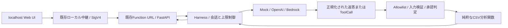

# v0.5設計：会話と許可済みCSV分析ツール

作成日：2026-10-12。設計・実装計画のみ。v0.5コード、AWS設定、IAM、配備は未変更。
前提となる完成ソースはタグ `v0.4`、コミット `8336241`。

## 目的と初期範囲

汎用会話を基本動作として維持し、必要な場合だけモデルがCSV分析ツールを選ぶ。
ツール利用を毎回強制しない。初期範囲は小さなCSVの読取・集計・結果の説明であり、
在庫の書換え・外部送信・任意コード実行・自動ファイル保存は含めない。
v0.4の画面履歴は表示専用で、モデルに過去の会話は渡していない。
v0.5では直近会話を明示的に送信する機能を追加し、サーバー永続化は行わない。

## 責任と経路

BackendはHTTP入力検証と応答のみ、Harnessはモデル選択・会話・ツール実行制御、
アダプターはプロバイダーの通信と形式変換、ツールは検証済みデータの計算に限定する。
モデルのToolCallは提案として扱い、実行権限・予算・承認をモデルへ委譲しない。
現行 `process_message(message)->str` と `generate_response(message)->str` を残し、
新しい構造化ターン処理を追加して既存利用箇所との互換性を保つ。

提案配置（将来追加するファイルで、今回は未作成）：

| 場所 | 責任 |
|---|---|
| app/harness/contracts.py | Conversation、ModelTurn、ToolCall、ToolResult、Usage共通型 |
| app/harness/orchestrator.py | 対話ループ、締切、回数、費用予算 |
| app/harness/tools/registry.py | サーバー固定Allowlist、スキーマ、承認区分 |
| app/harness/tools/csv_analysis.py | CSV解析、列情報、欠損・統計・集計 |
| 既存各アダプター | 新しい構造化turnインターフェースを併設 |
| 既存API・local_web | 任意の会話/CSVコンテキスト、画面表示、安全な転送 |

## 既存AWS基盤を維持する方法

同じFunction URL、AWS_IAM、Lambda名、実行ロール、arm64 Python 3.13、Mangum、
Secretを使用する。CSVは1回のリクエストに含め、Lambdaメモリ内だけで処理する。
標準ライブラリcsv/statistics/decimalで足りる範囲にし、PandasやS3を初期必須にしない。
実装時のコード配備には承認済みのイメージ更新が必要だが、AWSリソース構成やIAMの
追加は初期範囲では不要。今回の設計作業では配備しない。

Lambdaメモリや/tmp、グローバル変数は複数リクエスト間の保存場所として使用しない。
会話とCSVはブラウザのメモリ内に保持し、後続ターンで必要な分だけ再送する。
ページ再読み込みで消えることをUIに表示する。既存16 KiBリクエスト上限を維持し、
JSONエスケープ、会話、CSVを含む全体サイズをブラウザ・中継・Backendで検証する。
CSV単体の予備上限はUTF-8で8 KiB。大規模CSVは対象外として明確に拒否する。
この制限内で収まらない会話は古いターンを削り、CSVを黙って切り詰めない。

POST /chatは既存 `{message}` をそのまま受け付け、任意の `context` を追加する案。
contextは会話（user/assistantのみ）、CSV本文、表示名を持つ。system/toolロールや
ToolResultをクライアントから受け入れない。表示名はパスとして扱わない。
既存 `{response}` を必須のまま保ち、任意のusage/tool_summary/warningsを追加する。
アップロードはページでファイルを読み、JSONで送信する。ローカル任意パスやURLは
受け付けず、別の外部通信経路を作らない。会話内容は信頼できる命令として扱わない。

## AllowlistとCSV入力

最初の公開ツールは `csv_analyze` の1個に絞る。operationをenumで
`describe`、`numeric_summary`、`group_aggregate` に制限する。
引数：request内データを指すdataset_id、operation、columns、group_by、aggregation。
nullable項目を含む固定JSON Schemaを用い、additionalProperties=falseとする。
dataset_idは検証済み本文のハッシュからサーバーで作り、そのリクエスト内のデータだけを
参照できる。モデルからCSV本文・ファイルパス・任意URLをツール引数に渡さない。

Python標準csvでUTF-8（BOM許容）を解析。ヘッダー必須、重複/空列名拒否、
1000行・50列・1セル2048文字を暫定上限とし、行ごとの列数不一致・NUL文字を拒否。
数値は有限値のみ。NaN/Infinityは拒否し、空欄と数値でないセルを分けて欠損数を返す。
金額の集計はDecimalを使用し、浮動小数丸めの意味を結果に示す。
未知の列、未対応集計、全欠損、0除算は検証済みのエラーとして返す。
グループ件数・出力行数を20、ツール結果を4 KiBに制限し、切詰めの有無を明示する。

CSVセルの命令文はデータであり、ツール追加・権限変更・外部送信の承認にならない。
モデルには初期の列構造・件数と必要最小限の集計だけを渡し、CSV全文/生の各行を
原則送信しない。ただし列名・集計自体もOpenAIへ送信されるため、初回のデータ送信前に
送信先と送信範囲を画面で確認させる。CSV/回答/引数をログに記録しない。
UI表示はtextContentを維持し、CSV式やHTMLを実行しない。

## 承認区分

| 操作 | v0.5の扱い |
|---|---|
| 添付CSVのメモリ内読取・集計 | データ送信範囲にユーザーが同意した後は自動実行可 |
| 短い会話と計算結果をLLMへ送信 | UI送信操作で予算内の対話ループを明示承認 |
| レポートを画面に表示 | 自動可 |
| ファイルのダウンロード・保存 | 将来、ユーザーの明示クリックで実行 |
| 在庫更新、外部送信、削除、AWS操作 | 初期Allowlistに登録せず実行不可 |

将来の書込ツールは対象・変更前後・副作用・費用を表示して操作ごとに承認する。
承認はモデルの引数にあるapproved=trueなどを信用しない。
初期段階では承認待ち操作を検出したら実行せず回答を返して終了する。
将来の承認再開は、ローカル中継で保存した正規化操作・引数ハッシュ・期限・一回限りIDに
紐づけ、再送/改ざん/二重実行を拒否する設計を別途追加する。Lambda単独のメモリ保存では
複数インスタンスをまたぐ承認・重複防止を保証できないため、書込対応時に再設計する。

## 対話ループ・上限・失敗処理

1. Backendが全入力を検証。CSV解析・dataset登録は決定的に行う。
2. Harnessがプロバイダーに会話と許可済みスキーマだけを送る。
3. テキストのみならそのまま返す。ToolCallならAllowlist・引数・予算・承認を検証。
4. CSV関数を1回実行し、call_idに紐づくToolResultを追加して次のturnへ進む。
5. 最終テキスト、または固定の失敗理由/上限到達を返す。

暫定上限：1ユーザー送信でモデル通信2回、ツール実行1回、並列呼出し無効、
モデル出力各1024トークン、入力各4096トークン相当、総締切120秒、ツール処理2秒。
複数ToolCall・未知ツール・上限超過は実行しない。費用上限は例えば$0.01/送信。
現在の512トークンでは推論が未完了になる可能性があるため、増量は実装時に明示検討する。
AWS環境変数の変更を必要としないようツールループの予算は初期コード設定に置く案とする。

プロバイダーごとに対応モデルの価格表とUsageを使い、次の呼出し前に残予算を確認する。
金銭見積りは価格更新/推論トークンに依存し厳密な請求上限ではない。
未知の価格・使用量で追加呼出しをしない。ローカルのトークン見積りだけに頼らず、
入力バイト上限と保守的な予算予約、API max_output_tokensを併用する。
利用者にはツール付送信で最大2回のLLM通信が発生することを表示する。

タイムアウト/429/料金不足/不明な通信結果は再試行しない。
CSVの検証エラーは安全な固定ToolResultを返せるが、無限修正ループは許さない。
CSV実行が成功し最終LLMが失敗した場合、検証済み集計を画面に示し、
「集計成功・説明生成失敗」と区別する。HTTPのプロバイダー失敗は既存502契約を維持。
実行ログはcorrelation ID、固定ツール名、結果分類、時間、回数、Usage/費用見積りのみ。
質問・CSV・Secret・例外本文は記録しない。

## アダプター互換性

共通ModelTurnはText/ToolCall/Usage/FinishReasonを持つ。Mockは固定シナリオで
ツールあり/なし/不正呼出し/予算到達を再現する。既存のEcho動作も維持する。
OpenAIはResponses function_callとfunction_call_outputをcall_idで対応付ける。
store=falseを維持し、reasoning item等の次ターンに必要なプロバイダー要素は
リクエスト内のopaque stateとして保持する（クライアントから任意に注入させない）。
strict=true、tool_choice=auto、parallel_tool_calls=falseを使う。
BedrockはConverseのtoolUse/toolResultとtoolUseIdを共通型へ変換する。
ツール対応可否をモデルごとに確認し、未対応モデルは通常会話を維持して機能不足を表示。
JSONテキストをevalするような擬似ツール呼出しや、無断のプロバイダー切替は行わない。
Bedrockの実通信成功・モデル対応確認は今後の承認済み検証まで未確認と明示する。

参照：[OpenAI function calling](https://developers.openai.com/api/docs/guides/function-calling)、
[Bedrock tool use](https://docs.aws.amazon.com/bedrock/latest/userguide/tool-use.html)。
公式資料の変更に備え、実装着手時に使用モデルとSchema/turn継続仕様を再確認する。

## 実装計画と完了条件

| 段階 | 内容 | 難易度 / 目安 |
|---|---|---|
| 1 | 共通型、固定Registry、入力検証、純粋CSV分析、Mock turn | 中 / 1–2日 |
| 2 | Harnessループ、締切/回数/費用、エラー分類 | 中〜高 / 1–2日 |
| 3 | OpenAI/Bedrock形式変換とMock通信テスト | 高 / 1–2日 |
| 4 | 会話・CSV UI、送信同意、表示、既存安全対策 | 中 / 1–2日 |
| 5 | 95件回帰＋新規テスト、承認後だけ限定E2E/配備 | 中 / 1日 |

目安は合計5–9作業日（モデル仕様や既存テスト調整で変動）。小さな読取専用CSVなら
追加AWSサービス不要。在庫永続化、複数利用者、非同期処理、大容量データ、強い
二重実行防止が必要になった段階でS3/DynamoDB等を別途設計・承認する。

新規テストは通常会話でツールを使わないこと、unknown tool拒否、引数偽装、
列/サイズ/NaN/欠損/日本語CSV/不正UTF-8、CSV内プロンプト注入、LLM回数2回上限、
ツール1回上限、timeout/429/usage欠落、承認なし副作用拒否、XSS/CSRF/Host/Origin、
アダプター間call ID整合、Warm Lambdaで前のCSVが残らないことを検証する。
実装完了条件は95件を含む回帰成功、Mock E2E、安全対策維持、予算説明と
集計値の決定的な正解確認。実モデルE2Eは別承認後、最少回数で検証する。

## 残る制約

CSV転送には内容のプライバシー判断が必要。集計・モデルの説明は誤解釈を生む可能性が
あるため、対象列/件数/欠損/単位を必ず併記する。直近会話は上限内にしか保持できない。
外部LLMの料金上限は絶対保証ではなく、請求/プロジェクト予算の監視が別途必要。
在庫の確定更新や管理権限拡大はこの設計の初期範囲には含まれない。
